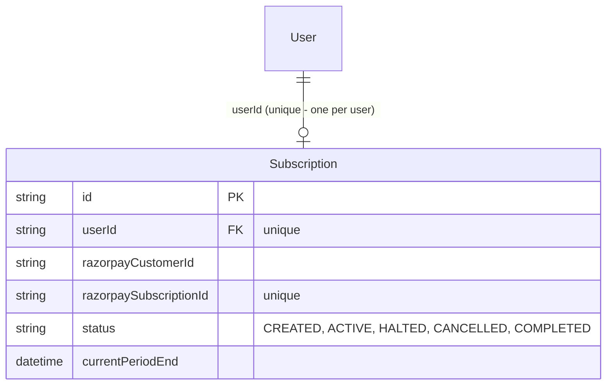
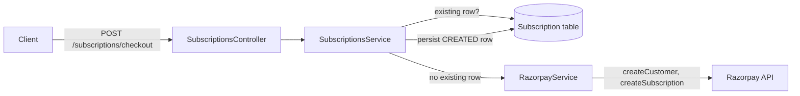
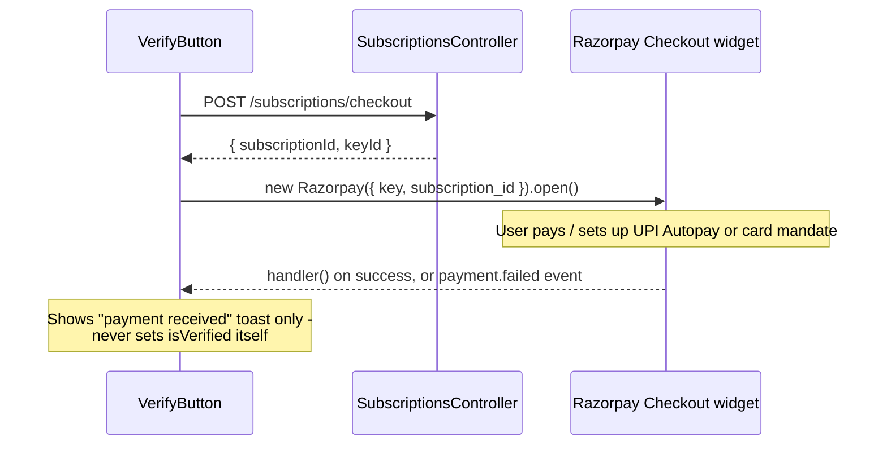
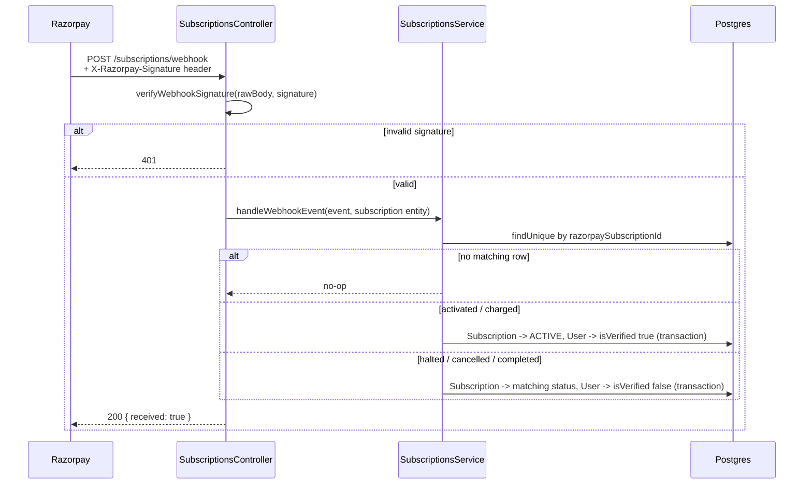
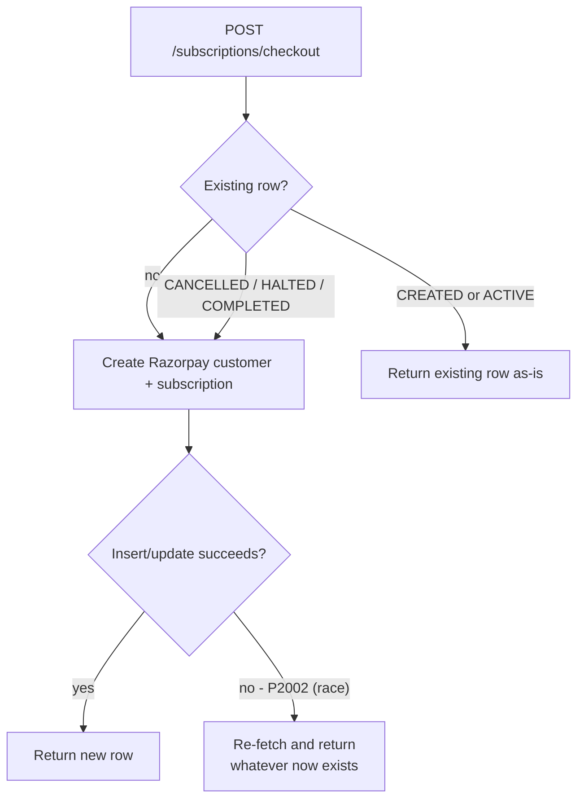

> **Removed 2026-09-17.** This feature was fully built and working (see below), but was pulled before the app's first deploy since it depended on a real Razorpay production account that doesn't exist yet — shipping it half-configured didn't make sense. See `docs/changes/2026-09-17-remove-blue-tick-verification.md`. This document is kept as a historical record of the implementation, not as documentation of a currently-running feature.

# Blue Tick Verification System Architecture

**Status:** All 5 phases implemented. **Phases 3, 4, and 5 fully verified end-to-end.** **Phases 1-2's *outbound* checkout path remains implemented but only verifiable up to the credential boundary** — every code path correctly reaches Razorpay's live test API and fails with a genuine auth error against the placeholder keys currently in `.env`. That's the one thing still blocked on real Razorpay test-mode signup; everything else in the feature (webhook handling, the badge, the edge cases below) has been proven with real requests against the live app and database.

## Phase 0 — Locked Decisions

| Decision | Choice |
|---|---|
| Payment gateway | Razorpay (Stripe's recurring billing isn't practical for an individual/unregistered business in India) |
| Launch scope | Test/sandbox mode only for now — real KYC and live keys deferred |
| Price | ₹99/month |
| What verification unlocks | Just the badge — no other feature gating |

## Phase 1 — Backend Foundation (Implemented)

**Schema** (`server/prisma/schema.prisma`): added `isVerified Boolean @default(false)` to `User` (a denormalized flag so every place that renders a username can check it with zero extra joins — set only by the webhook in Phase 3, never directly), and a new `Subscription` model:

`userId` is `@unique` — one subscription row per user. This is a deliberate simplification: a user who cancels and later wants to resubscribe isn't handled yet. Revisit in a later edge-case phase, not now.

**New `server/src/subscriptions/` module**:
- `razorpay.service.ts` — thin wrapper around the official `razorpay` SDK. `createCustomer()` uses `fail_existing: 0` so retrying a failed checkout doesn't create duplicate Razorpay Customer records for the same email. `createSubscription()` creates the Subscription shell against the Plan (`RAZORPAY_BLUE_TICK_PLAN_ID`), stamping `notes.userId` so a webhook can be traced back to a local user.
- `subscriptions.service.ts` — `createCheckoutForUser(userId)`: returns the existing `Subscription` row if one already exists (idempotent), otherwise creates a Razorpay Customer + Subscription and persists a new row with `status: CREATED`.
- `subscriptions.controller.ts` — `POST /subscriptions/checkout` (JWT-guarded, same `AuthGuard('jwt')` + `req.user.userId` pattern used by every other controller in this app) returns `{ subscriptionId, keyId }` — only the public Key ID ever leaves the server, never the secret.

**Important design note**: the Razorpay Customer actually billed is determined when the user completes Checkout in Phase 2 — Razorpay's classic Subscriptions API has no `customer_id` field to pre-link a Customer at creation time (confirmed against the SDK's own TypeScript definitions, not assumed). The `createCustomer()` call here is purely for our own bookkeeping/reference; Razorpay manages the actual billing identity internally once payment happens.

### A real gap this surfaced: the app can't boot without Razorpay keys

The Razorpay SDK throws synchronously in its constructor if `key_id` is missing (`` `key_id` or `oauthToken` is mandatory ``), and `RazorpayService` is a normal eagerly-instantiated NestJS provider — so an unset env var doesn't fail one request, it crashes the entire server at startup. Placeholder values (`RAZORPAY_KEY_ID=rzp_test_placeholder`, etc.) were added to `server/.env` so the server keeps booting; real test-mode values need to replace them before Phase 1 can be fully exercised.

### Verification

1. `npx prisma migrate dev` applied cleanly against the live Neon DB — no drift.
2. `npx tsc --noEmit` clean.
3. Server boots cleanly with placeholder keys; `POST /subscriptions/checkout` route is correctly registered.
4. Called the endpoint with a real logged-in user's cookie — reached the real Razorpay test API (not a code-level failure) and got back a genuine `401 Authentication failed`, confirming the auth guard, service wiring, and Razorpay SDK call shape are all correct up to the credential boundary.
5. **Not yet verifiable**: a successful subscription creation, and the idempotency check's second-call behavior — both require real Razorpay test credentials.

## Phase 2 — Frontend Checkout Flow (Implemented)

**New `client/src/components/verify-button.tsx`** — the "Get Verified" entry point. On click: calls `POST /subscriptions/checkout`, dynamically injects Razorpay's Checkout.js script (only when actually needed, not on every page load), and opens the widget with the returned `subscriptionId`/`keyId`.

**Critical design point**: the widget's own success `handler()` callback is **never** trusted to grant the badge. It only shows a "payment received, badge will appear once confirmed" toast. The actual `isVerified` flip is reserved entirely for the server-side webhook in Phase 3 — a client-side callback can be spoofed or interrupted mid-flow, so it can't be the source of truth for anything that unlocks a real feature.

**Wired into `/profile/[username]`**: the button appears next to the existing self-profile actions (Edit Profile / Requests) only when `!profile.isVerified`. When `isVerified` is true, a small badge icon renders next to the username instead. `GET /users/:username` now returns `isVerified` (`server/src/users/users.service.ts`). This is a minimal, single-page rendering — the full "badge appears everywhere a username is shown" rollout (chat, posts, comments) is still Phase 4 scope, not done here.

### Verification

1. `npx tsc --noEmit` clean on both `client` and `server`.
2. Logged in, opened own profile — confirmed the "Get Verified" button renders (and would be replaced by the badge icon once `isVerified` is true, though that can't be triggered yet without Phase 3's webhook).
3. Clicked it — confirmed the checkout request fires, and (as expected with placeholder keys) the request fails with a `500` from Razorpay's auth rejection, surfaced correctly to the user as "Could not start checkout - please try again." rather than crashing or hanging silently.
4. **Not yet verifiable**: the actual Checkout widget opening and completing a payment - both require real Razorpay test credentials.

## Phase 3 — Webhook Handling (Implemented)

This is the only place `isVerified` is ever written server-side, and the only phase that could be fully verified without real Razorpay credentials — a webhook is just an inbound POST with an HMAC signature computed the same deterministic way regardless of whether the account is real or a placeholder.

**`main.ts`**: `NestFactory.create(AppModule, { rawBody: true })` — needed because signature verification must run over the *exact* raw bytes Razorpay sent, not a re-serialized copy of the parsed JSON body (which can differ in key order/whitespace and would make every signature check fail).

**`razorpay.service.ts`**: `verifyWebhookSignature(rawBody, signature)` wraps the SDK's own `Razorpay.validateWebhookSignature()` (confirmed against its actual source: HMAC-SHA256 over the raw body string, keyed with the webhook secret, compared to the header).

**`subscriptions.service.ts`**: `handleWebhookEvent(event, subscriptionEntity)` — looks up the `Subscription` row by `razorpaySubscriptionId`; if none matches, ignores the event (a webhook from a subscription this app doesn't know about, or a stale replay, isn't an error). On `subscription.activated`/`subscription.charged`, sets `status: ACTIVE` and extends `currentPeriodEnd`, and sets `User.isVerified = true` — both in one `$transaction`. On `subscription.halted`/`cancelled`/`completed`, sets the matching status and `isVerified = false`, also transactionally.

**`subscriptions.controller.ts`**: `POST /subscriptions/webhook` (no auth guard — this is Razorpay calling in, not a logged-in user) verifies the signature first and throws `401` before touching anything else if it fails.

### A real bug found and fixed during verification

The first full test run returned `500` on *every* call, including ones with a correct signature. Root cause: the dev server process serving requests had booted before `RAZORPAY_WEBHOOK_SECRET` was added to `.env`, so `process.env.RAZORPAY_WEBHOOK_SECRET` was `undefined` in that running process - and the Razorpay SDK's `validateWebhookSignature` throws synchronously (not a rejected promise) when any of its three arguments is undefined, which surfaced as an uncaught 500 instead of a clean 401. Separately, it turned out `nest start --watch` on this machine doesn't reliably keep piping a respawned child process's stdout to the same captured log file across restarts - the background task's log looked "stuck" on an old snapshot even though the live server had moved on. Fixed by doing a full manual kill-and-restart rather than trusting the watcher's silent respawn, which also picked up the already-correct `.env` value.

### Verification

Real signature computation and a real seeded `Subscription` row (Razorpay credentials aren't needed for this phase - a webhook call is indistinguishable from real whether the account behind it is a placeholder or not):
1. Seeded a `CREATED` subscription row for a real user, directly in Postgres.
2. Sent a webhook with an **invalid** signature - got `401`, confirmed the DB row was untouched.
3. Sent a real `subscription.activated` event with a correctly computed HMAC signature - confirmed the `Subscription` row flipped to `ACTIVE` with the right `currentPeriodEnd`, **and** `User.isVerified` flipped to `true`.
4. Sent `subscription.charged` (a renewal) - confirmed it stayed `ACTIVE` and `currentPeriodEnd` correctly advanced to the new period.
5. Sent `subscription.cancelled` - confirmed `status: CANCELLED` and `User.isVerified` flipped back to `false`.
6. Sent a webhook referencing a subscription id that doesn't exist in the DB - confirmed a clean `200` with no crash and no DB write, rather than an error (Razorpay retries non-2xx responses, so silently ignoring what isn't ours avoids pointless retry storms).
7. `npx tsc --noEmit` clean.

## Phase 4 — Badge UI Everywhere (Implemented)

Every backend `select`/`include` that returns a user object visible to another viewer now includes `isVerified`, and a shared `client/src/components/verified-badge.tsx` renders it consistently everywhere a username appears:

| Surface | Backend source | Frontend file |
|---|---|---|
| Profile page | `users.service.ts: getProfile` | `profile/[username]/page.tsx` (Phase 2) |
| Post author (feed + explore grid's underlying query) | `posts.service.ts: getFeed`, `getExploreFeed` | `components/post-card.tsx` |
| Comment author | `posts.service.ts: addComment`, `getComments` | `components/comment-section.tsx` |
| Notification actor | `notifications.service.ts: list` | `app/(main)/notifications/page.tsx` |
| Follow request sender | `follow.service.ts: listPendingRequests` | `app/(main)/profile/requests/page.tsx` |
| Chat conversation list | `chat.service.ts: listConversations` | `app/(main)/chat/page.tsx` |
| Chat header | `chat.service.ts: resolveUser` (via `getOrCreateConversation`) | `app/(main)/chat/[username]/page.tsx` |
| User search / explore | `users.service.ts: searchUsers` | `app/(main)/explore/page.tsx` |
| Call overlay (incoming + connected) | `calls.service.ts: getPublicUser` | `components/call-overlay.tsx` (via `CallPeer` in `useCall.ts`) |

Deliberately **not** duplicated: the caption line under a post (`"username caption text"`) doesn't repeat the badge already shown in the post header a few pixels above it — same reasoning Instagram itself uses, avoiding visual noise rather than mechanically stamping every text occurrence of a username.

### A real bug found and fixed during verification

An `Edit` with `replace_all: true` was used to add `isVerified` to two identical `author: { select: {...} }` fragments in `posts.service.ts` (`getFeed` and `getExploreFeed`) - both landed correctly. A **separate** edit, also `replace_all: true`, targeted two identical `include: { user: { select: {...} } }` fragments (`addComment` and `getComments`) - but only `addComment`'s actually changed; `getComments` silently kept the old select with no `isVerified`. This was caught directly by verification, not by inspection: the POST-comment response (immediately after adding a comment) correctly included `isVerified: true`, but the GET-comments response (the one that loads a post's comment thread) didn't - the badge only ever appeared for a comment you'd *just* posted in the same session, not on reload. Fixed by editing `getComments`'s select directly and re-verifying the GET response.

**How to notice this yourself in future**: a `replace_all` reporting success doesn't guarantee every visually-identical occurrence was semantically the one you meant to change - always spot-check with a direct API call (or grep) after the edit when two call sites happen to share the exact same string, rather than trusting the tool's success message alone.

### Verification

Full live pass, `alex_wanders.isVerified` flipped to `true` directly in Postgres, `mia.codes` as the viewer for every surface:
1. Profile page - badge visible.
2. Home feed - created a real post via the API, confirmed the badge on its author line (initially failed - turned out to be the pre-existing 30s Redis feed cache, not a bug, confirmed by retrying after the TTL expired).
3. Comment section - posted a real comment, confirmed badge count went from 1 (post header) to 2 (post header + comment) once the `getComments` bug above was fixed.
4. Notifications - sent a real follow request, confirmed the badge next to the actor.
5. Follow requests page - confirmed the same pending request shows the badge here too.
6. Explore search - searched for the verified user, confirmed the badge in results.
7. Chat list and chat header - confirmed the badge in both.
8. Call overlay - placed a real call, confirmed the badge on the incoming-call screen next to the caller's name.
9. `npx tsc --noEmit` clean on both projects throughout.

## Phase 5 — Edge Cases + Final Verification (Implemented)

Two real gaps, both in `subscriptions.service.ts: createCheckoutForUser`, both flagged as known simplifications back in Phase 1 rather than fixed then:

**1. The resubscribe gap.** The original code was `if (existing) return existing;` — unconditional. Once a user's subscription resolved to `CANCELLED`, `HALTED`, or `COMPLETED`, every future click on "Get Verified" would keep handing back that same dead subscription id forever, with no way to actually pay again. Fixed: the early return now only fires for a *live* row (`CREATED` or `ACTIVE`) — anything else falls through and creates a fresh Razorpay subscription, `update`-ing the existing row in place (can't `create` a second one; `userId` is `@unique`) rather than returning stale data.

**2. Concurrent double-click.** Two rapid clicks on "Get Verified" could both pass the `findUnique` check (no existing row yet) before either had written one, then race each other to insert - the second would hit the DB's unique constraint on `userId` and throw. Fixed: wrapped the create/update in a `try/catch` for Prisma's `P2002` (unique violation) and, on that specific error, just re-fetches and returns whatever row the other request already created - treating a double-submit as a no-op instead of a crash.

### Verification

1. Seeded a `CANCELLED` row, called checkout - confirmed it did **not** return the stale id, and correctly attempted (and failed against the placeholder keys with the same `500` boundary as every other outbound call) a fresh Razorpay request. Repeated for `HALTED` - same result.
2. Seeded an `ACTIVE` row, then a `CREATED` row - confirmed both cases returned the existing subscription id untouched, with **no** attempted Razorpay call (a clean `201`, not the `500` a fresh attempt would produce).
3. Directly triggered a duplicate-`userId` insert against Postgres outside the app to confirm the error code really is `P2002` - the assumption the `catch` block depends on.
4. **Full combined pass**, mirroring video-calling's Phase 5 approach - one continuous run touching every phase together plus a regression check on unrelated features:
   - Webhook `subscription.activated` → badge appears on the profile page.
   - The **same** webhook event delivered a second time (Razorpay's at-least-once delivery model) → stays `ACTIVE`, no duplicate side effects - confirms the handler is naturally idempotent.
   - Webhook `subscription.cancelled` → badge disappears.
   - Regression: post creation, liking, commenting, the notifications page, and the chat conversations list all still work - checked because Phase 4 touched `select`/`include` clauses across five different service files, and a typo there could have silently broken something unrelated.
5. `npx tsc --noEmit` clean on both projects.

## Still open

- Real Razorpay test-mode account + Plan still needed from the account owner before Phases 1-2's *outbound* checkout flow (the actual "click a button, pay, see the badge" experience) can be verified with a real payment. Every other part of the feature - webhook handling, the badge, and now the edge cases - has been fully proven independently of Razorpay credentials.
- Not attempted, and flagged as a conscious scope boundary rather than an oversight: protection against **out-of-order** webhook delivery (e.g. a delayed `subscription.charged` arriving after a `subscription.cancelled` for the same cycle). Razorpay's webhooks are at-least-once but not guaranteed-ordered; the current handler just applies whatever it receives last. For a single-badge, ₹99/month feature at this scale, the added complexity (tracking and comparing event timestamps per subscription) wasn't judged worth it yet - revisit if this becomes a real support-inbox problem after going live.
