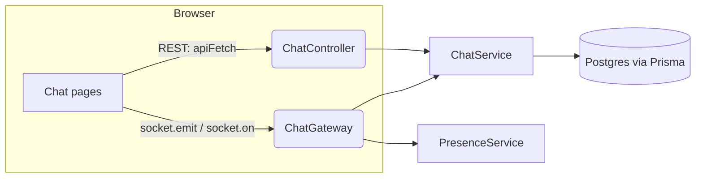

# Chat System Architecture

A complete reference for how real-time 1:1 messaging works in Sphere — every table, every API, every socket event, every function, and how a message actually moves from one browser to another.

## 1. High-level picture

Two separate transports are involved, each responsible for a different job:

- **REST (`GET`/`POST` over plain HTTP, via `apiFetch`)** — handles everything that isn't time-critical: loading the conversation list, loading message history, resolving/creating a conversation, marking things read, reading unread counts. Cookie-authenticated (`AuthGuard('jwt')`, same as every other controller in this app).
- **WebSocket (socket.io, one persistent connection per browser tab, via `getSocket()`)** — handles everything that must feel instant: sending a message, typing indicators, read receipts arriving live, and online/offline presence. Authenticated once at connection time, not per-event.



Both the controller and the gateway are thin — almost all actual logic (DB queries, permission checks, business rules) lives in `ChatService`. Neither the controller nor the gateway talk to Prisma directly.

## 2. Data model (`server/prisma/schema.prisma`)

```prisma
model Conversation {
  id        String    @id @default(cuid())
  user1Id   String
  user2Id   String
  user1     User      @relation("ConversationUser1", fields: [user1Id], references: [id], onDelete: Cascade)
  user2     User      @relation("ConversationUser2", fields: [user2Id], references: [id], onDelete: Cascade)
  messages  Message[]
  createdAt DateTime  @default(now())
  updatedAt DateTime  @updatedAt

  @@unique([user1Id, user2Id])
  @@index([user1Id])
  @@index([user2Id])
}

model Message {
  id             String       @id @default(cuid())
  conversationId String
  conversation   Conversation @relation(fields: [conversationId], references: [id], onDelete: Cascade)
  senderId       String
  sender         User         @relation(fields: [senderId], references: [id], onDelete: Cascade)
  text           String
  read           Boolean      @default(false)
  createdAt      DateTime     @default(now())

  @@index([conversationId, createdAt, id])
  @@index([conversationId, read])
}
```

**Key design decisions, and why:**

- **One `Conversation` row per pair of users, ever.** There's no "create a new conversation" action — `getOrCreateConversation` either finds the existing row or makes one, lazily, the first time anyone messages anyone. This is why `@@unique([user1Id, user2Id])` exists: it's the database-level guarantee that two people can never end up with two separate conversation threads.
- **Canonical ordering makes that uniqueness actually work.** If Alex messages Mia first, naively you'd store `(user1Id: alex, user2Id: mia)`; if Mia messages Alex first some other time, you'd get `(user1Id: mia, user2Id: alex)` — a *different* row, defeating the unique constraint entirely. The fix: every single lookup and creation sorts the two ids first — `const [user1Id, user2Id] = [meId, other.id].sort()` — so the pair is always stored in the same alphabetical order regardless of who initiated. `otherParticipantId()` is the inverse of this: given a conversation row and "my" id, it returns whichever of `user1Id`/`user2Id` isn't me.
- **`read` lives on the `Message`, not the `Conversation`.** This is what makes per-message read receipts (the ✓/✓✓ ticks) possible — a coarser "conversation-level last-read timestamp" design couldn't distinguish "he's seen your 3rd-to-last message but not your last one."
- **No `Notification` rows are created for chat messages.** This is a deliberate separation from the app's other `Notification` model (likes/comments/follows) — chat has its own independent unread-count and toast system, mirroring how real chat apps keep DMs and activity notifications as separate concerns.

## 3. Complete REST API

All routes are under `@Controller('chat')` in `chat.controller.ts`, all guarded by `AuthGuard('jwt')`.

| Endpoint | Method | Controller method | Service function | Purpose |
|---|---|---|---|---|
| `/chat/conversations` | GET | `listConversations` | `ChatService.listConversations` | Inbox list: every conversation you're in, with the other person, their live online status, the last message, and your unread count for that thread. |
| `/chat/unread-count` | GET | `unreadCount` | `ChatService.unreadCount` | Total unread messages across *all* your conversations — feeds the bottom-nav badge. |
| `/chat/conversations/:username` | GET | `getOrCreateConversation` | `ChatService.getOrCreateConversation` | "Open a chat with this person" — resolves (or lazily creates) the conversation row, returns its id + the other user's public info (including live online status). This is what runs when you land on `/chat/[username]` or click Message on a profile. |
| `/chat/conversations/:id/messages` | GET | `listMessages` | `ChatService.listMessages` | Paginated message history (`limit`/`offset`, newest-first internally then reversed for display) — same `{ items, limit, offset, total, hasMore }`-style shape used by every other paginated list in this app (feed, explore, notifications). |
| `/chat/conversations/:id/read` | POST | `markRead` | `ChatService.markRead`, then `ChatGateway.notifyRead` | Marks every unread message *from the other person* in that conversation as read, and — if anything actually changed — tells the gateway to push a live `messages_read` event to that other person's socket. This is the one REST endpoint that reaches into the socket layer. |

## 4. Complete WebSocket event map

All socket handling lives in `chat.gateway.ts`. One connection per browser tab, opened lazily the first time `getSocket()` is called anywhere in the app (in practice: as soon as `BottomNav` mounts, which is on every page in the `(main)` layout — so a socket connects as soon as you're anywhere in the app, not just on a chat screen).

| Event | Direction | Handler | Calls into | Purpose |
|---|---|---|---|---|
| *(connection)* | client → server | `handleConnection` | `PresenceService.addConnection`, `ChatService.getConversationPartnerIds` | Verifies the JWT from the connection's cookie, joins the socket to room `user:<id>`, and — only if this is your *first* open tab — tells your conversation partners you're now online. |
| *(disconnection)* | client → server | `handleDisconnect` | `PresenceService.removeConnection`, `ChatService.getConversationPartnerIds` | Mirror image: only if this was your *last* open tab, tells your conversation partners you've gone offline. |
| `send_message` | client → server | `handleSendMessage` | `ChatService.sendMessage` | Persists the message, then emits `new_message` back out. |
| `typing` | client → server | `handleTyping` | `ChatService.getOtherParticipantId` | Relays "I'm typing" to the other participant only (not persisted anywhere). |
| `stop_typing` | client → server | `handleStopTyping` | `ChatService.getOtherParticipantId` | Relays "I stopped typing." |
| `new_message` | server → client | *(emitted from `handleSendMessage`)* | — | The saved message (including nested `sender: { username, avatarUrl }`), pushed to both the recipient's room *and* the sender's own room (so a sender's other open tabs also update). |
| `send_message_error` | server → client | *(emitted from `handleSendMessage`'s catch block)* | — | Sent back to the sender only, if `sendMessage` throws (e.g. you're not actually a participant in that conversation, or the trimmed text was empty). |
| `typing` / `stop_typing` | server → client | *(relayed by `handleTyping`/`handleStopTyping`)* | — | Same event names, now arriving at the *other* participant instead of the sender. |
| `messages_read` | server → client | *(emitted from `ChatGateway.notifyRead`, called by the REST controller)* | — | Tells the original sender their message(s) were just read — this is the only server→client event that originates from a REST call rather than a socket event. |
| `user_online` / `user_offline` | server → client | *(emitted from `handleConnection`/`handleDisconnect`)* | — | Sent only to your conversation partners' rooms (looked up via `getConversationPartnerIds`), never broadcast globally — presence is only ever relevant to people you've actually messaged. |

## 5. Frontend pieces and what each one owns

| File | Owns |
|---|---|
| `client/src/lib/socket.ts` | The single lazy socket singleton (`getSocket()`) — every component that needs the socket calls this same function and gets the same connection back. |
| `client/src/app/(main)/chat/page.tsx` | The inbox list: `GET /chat/conversations` via React Query, plus socket listeners for `new_message`/`user_online`/`user_offline` that invalidate that query so the list, previews, and presence dots update live while it's open. |
| `client/src/app/(main)/chat/[username]/page.tsx` | The actual conversation: loads history over REST once, then everything else — sending, receiving, typing, read receipts, presence for the header dot — is driven by the socket events listed above. |
| `client/src/components/bottom-nav.tsx` | Two things unrelated to any one conversation: the unread-count badge (`GET /chat/unread-count`, refreshed on a 30s poll *and* immediately on any `new_message`), and the global toast notification for incoming messages when you're not looking at that exact conversation. |

## 6. Walking through the four real flows end-to-end

### Sending a message

1. You type in the `<Input>` on `/chat/mia.codes` and hit Send. `sendMessage()` runs `getSocket().emit('send_message', { conversationId, text })` — note this is a socket emit, not an HTTP request.
2. `ChatGateway.handleSendMessage` receives it, reads `client.data.userId` (set once, back at connection time), and calls `chatService.sendMessage(userId, conversationId, text)`.
3. `sendMessage` in the service: re-verifies you're actually a participant in that conversation (`assertParticipant` — defense against a forged conversation id), trims the text and rejects empty strings, then does two Prisma calls in parallel — `message.create()` (with the sender's `username`/`avatarUrl` included, needed later for the toast) and `conversation.update()` bumping `updatedAt` (this is what keeps the inbox list sorted by most-recent-activity).
4. Back in the gateway, `this.server.to('user:<mia>').to('user:<you>').emit('new_message', message)` — one emit, targeting both rooms; socket.io delivers it once to every socket in either room, so both your own other open tabs and Mia's tabs all receive it.
5. On the receiving end, `onNewMessage` in `[username]/page.tsx` appends it to local state if you're looking at that exact conversation, and separately `bottom-nav.tsx`'s own `onNewMessage` listener invalidates the unread-count query and — if you're *not* looking at that exact conversation — shows the toast.

### Typing indicator

1. Every keystroke calls `handleTextChange`, which throttles to one `typing` emit per 2 seconds while you keep typing, and schedules a `stop_typing` emit for 2 seconds after you pause.
2. `ChatGateway.handleTyping` looks up the other participant via `getOtherParticipantId` and relays the event to their room only — nothing is written to the database, this never touches Postgres at all.
3. The recipient's page matches the `conversationId` and `userId` against the conversation it's currently showing, and flips on the bouncing-dots UI, with its own independent 4-second timeout as a safety net in case a `stop_typing` event is ever lost.

### Read receipts

1. Opening a conversation (or receiving a live message while it's open) triggers a plain `POST /chat/conversations/:id/read`.
2. `ChatController.markRead` calls `chatService.markRead`, which does one `updateMany` flipping every unread message *from the other person* to `read: true`, and returns how many rows actually changed plus who the other participant is.
3. If anything changed, the controller calls `this.chatGateway.notifyRead(conversationId, otherUserId)` — this is the one place a REST controller reaches directly into the socket gateway to push a live event.
4. The original sender's client receives `messages_read`, flips every message *they* sent in that conversation to `read: true` in local state, and the last one they sent re-renders with the blue "✓✓ Seen" tick.

### Online/offline presence

1. Presence is tracked purely in memory (`PresenceService`, a `Map<userId, Set<socketId>>`) — nothing about who's online is ever written to the database. The set (not just a boolean) is what correctly handles multiple open tabs: you only flip offline once your *last* socket disconnects.
2. On connect/disconnect, the gateway looks up your conversation partners (a live Prisma query — the one place this whole presence system touches the database at all) and emits `user_online`/`user_offline` only to those specific people's rooms, never a global broadcast.
3. Anyone who *wasn't* connected at that exact moment still sees the correct status the next time they load the inbox or open the conversation, because `listConversations` and `getOrCreateConversation` both stamp `online: presenceService.isOnline(id)` fresh on every request — the socket events are a live-update optimization on top of that, not the only source of truth.

## 7. Known limitations

- **Presence is single-instance.** `PresenceService`'s map lives in one Node process's memory. Fine for this app's single dev server; would need to move to Redis (already a dependency here) if this ever ran across multiple server instances.
- **No message length cap.** Neither the input nor `sendMessage` enforces a maximum length yet — a proposed, not-yet-applied fix from an earlier bug investigation.
- **`handleDisconnect` has a known unguarded `await`** — a database hiccup at the exact moment a socket disconnects can crash the entire Node process, because unlike `handleConnection` right next to it, this one has no try/catch. Diagnosed, fix proposed, not yet applied as of this writing.
- **DMs are open to anyone** — no restriction based on follow status, unlike the approval-gated Profile/Follow system elsewhere in the app.
