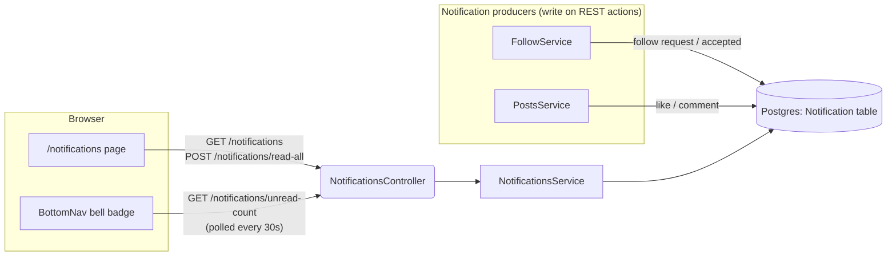
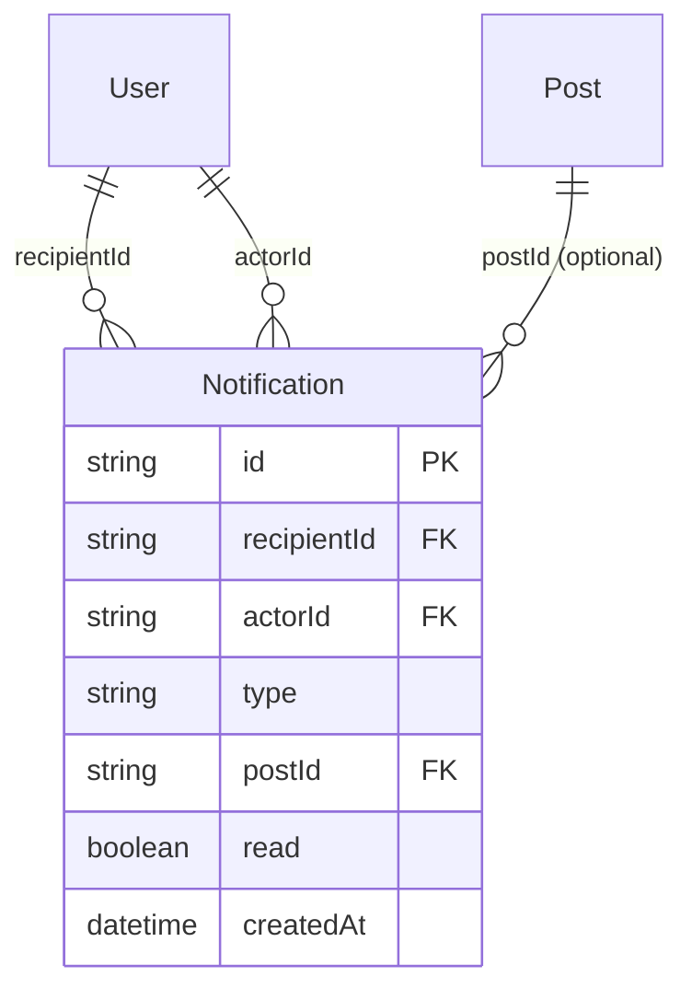
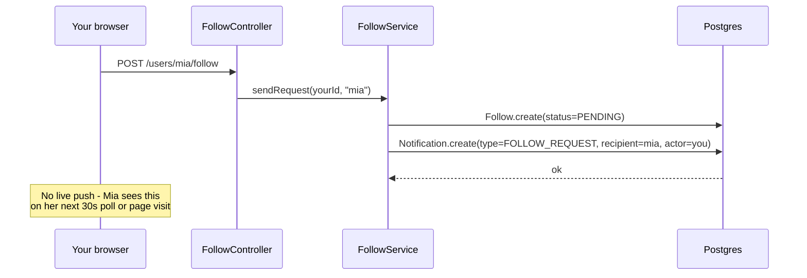
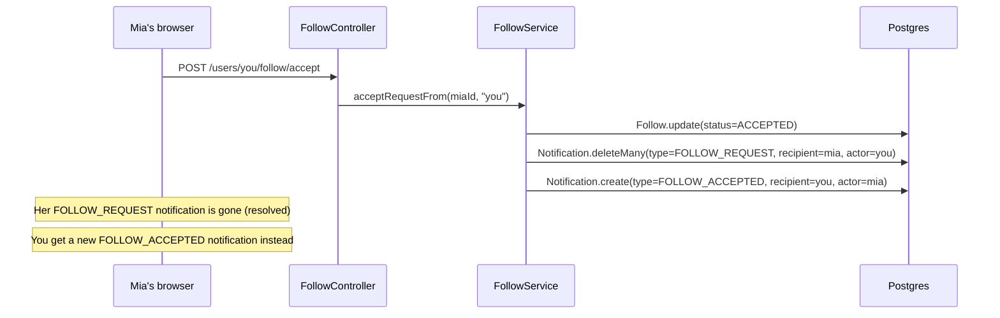
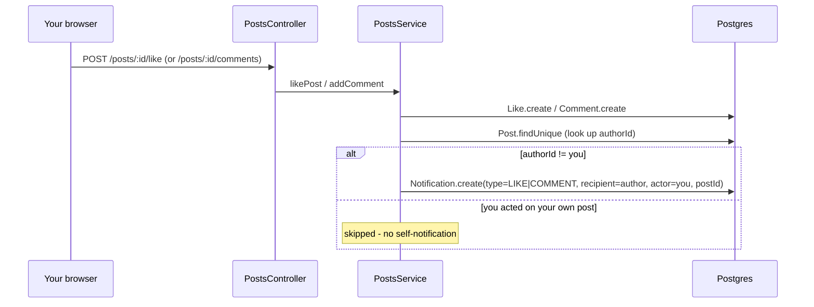
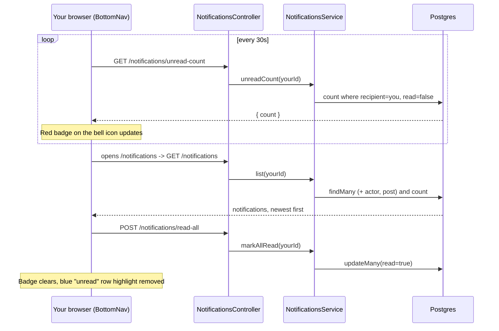

# Notifications System Architecture

## Architecture Diagram

**No WebSocket involved anywhere in this feature** — unlike chat, notifications are pure REST + a 30-second poll. The bell badge only updates when that poll fires or when you navigate to a page that refetches it.

## Data Model

`type` is one of `FOLLOW_REQUEST`, `FOLLOW_ACCEPTED`, `LIKE`, `COMMENT`. `postId` is only set for `LIKE`/`COMMENT`.

## Follow Request → Notification

## Accepting a Request: One Notification Resolves Into Another

Rejecting works the same way minus the final create step — the request notification is just deleted, silently.

## Like / Comment → Notification

## The Alert: Badge Polling + Reading the List

