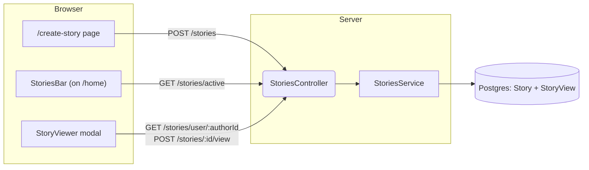
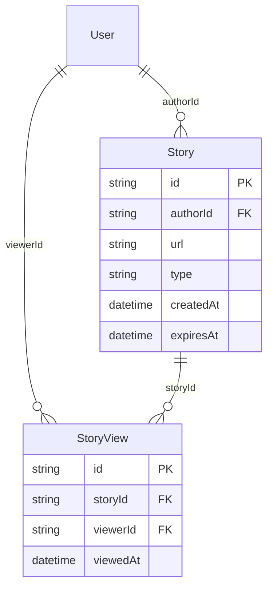
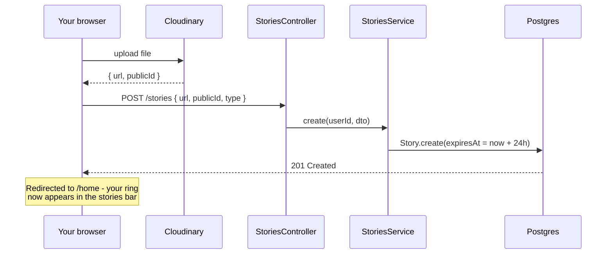
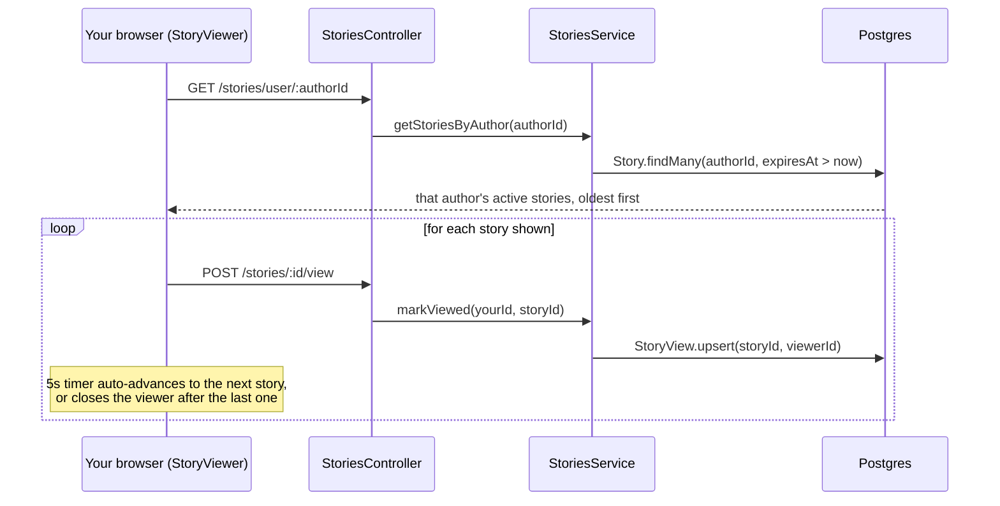

# Stories System Architecture

## Architecture Diagram



No WebSocket, no polling — every screen just fetches fresh on mount. A new story only becomes visible to others the next time they load `/home`.

## Data Model



`expiresAt` is set once, at creation, to `createdAt + 24h`. There's no cleanup job — expired stories aren't deleted, they just permanently stop matching any `expiresAt > now` query.

## Creating a Story



## Loading the Stories Bar (Grouping + Seen/Unseen Ring)

```mermaid
sequenceDiagram
    participant You as Your browser (StoriesBar)
    participant Ctrl as StoriesController
    participant Svc as StoriesService
    participant DB as Postgres

    You->>Ctrl: GET /stories/active
    Ctrl->>Svc: getActiveStories(yourId)
    Svc->>DB: Story.findMany(expiresAt > now, include views where viewerId=you)
    DB-->>Svc: all non-expired stories, each with your view (if any)
    Svc->>Svc: group by authorId; allSeen = every story in that group already has your view
    Svc-->>You: [{ author, storyIds, allSeen }]
    Note over You: allSeen=false -> colored gradient ring<br/>allSeen=true -> plain gray ring
```

## Viewing a Story


