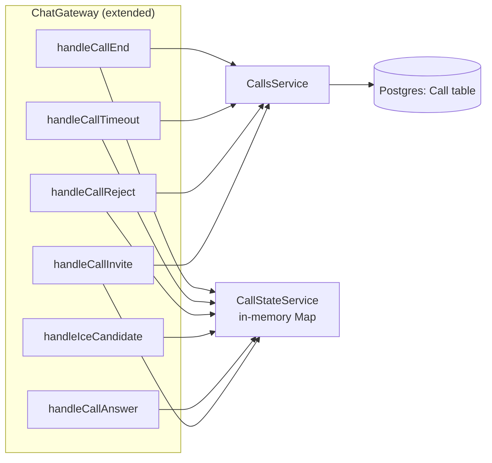
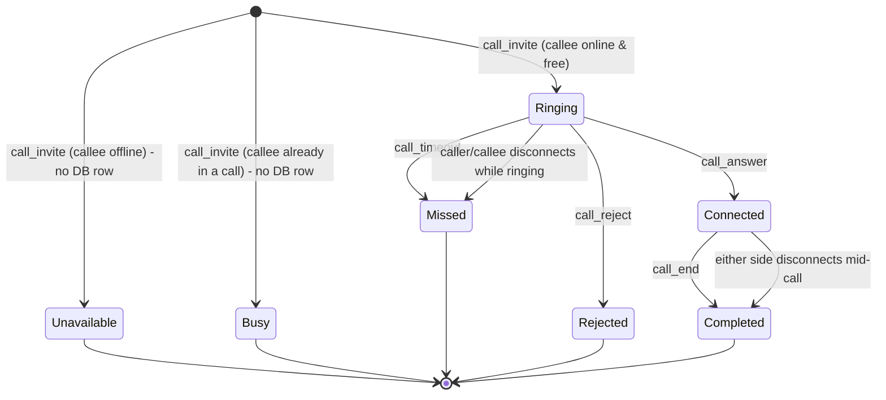
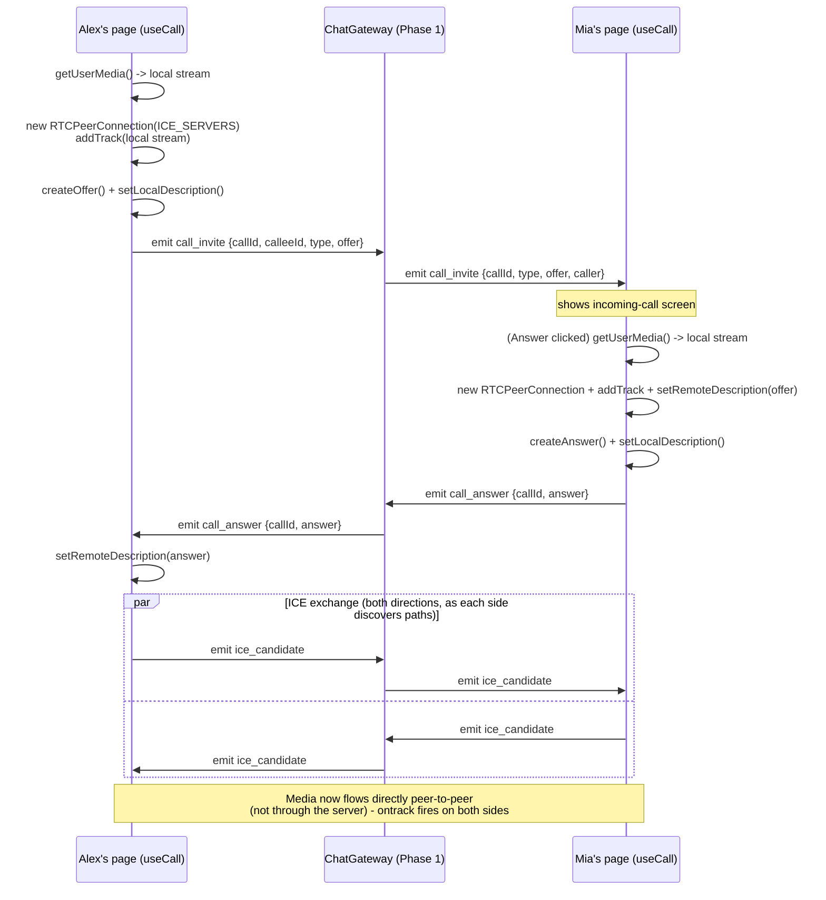
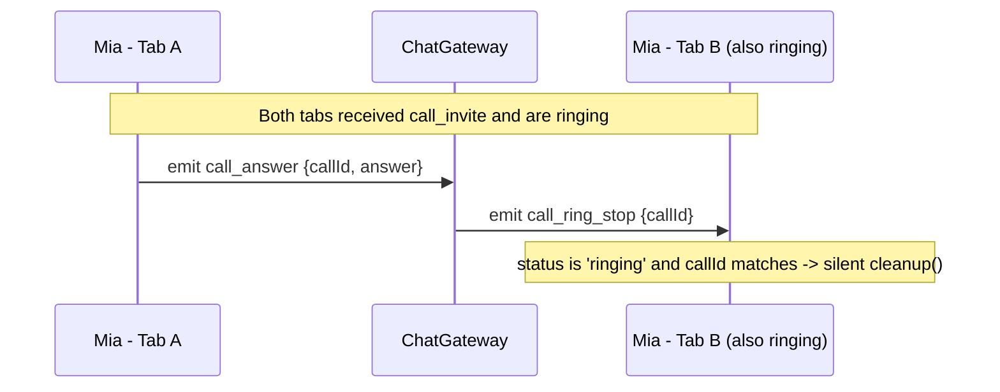
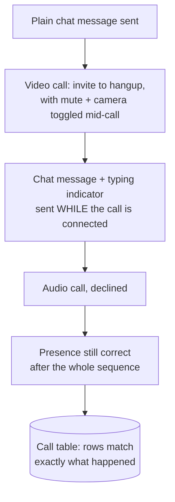
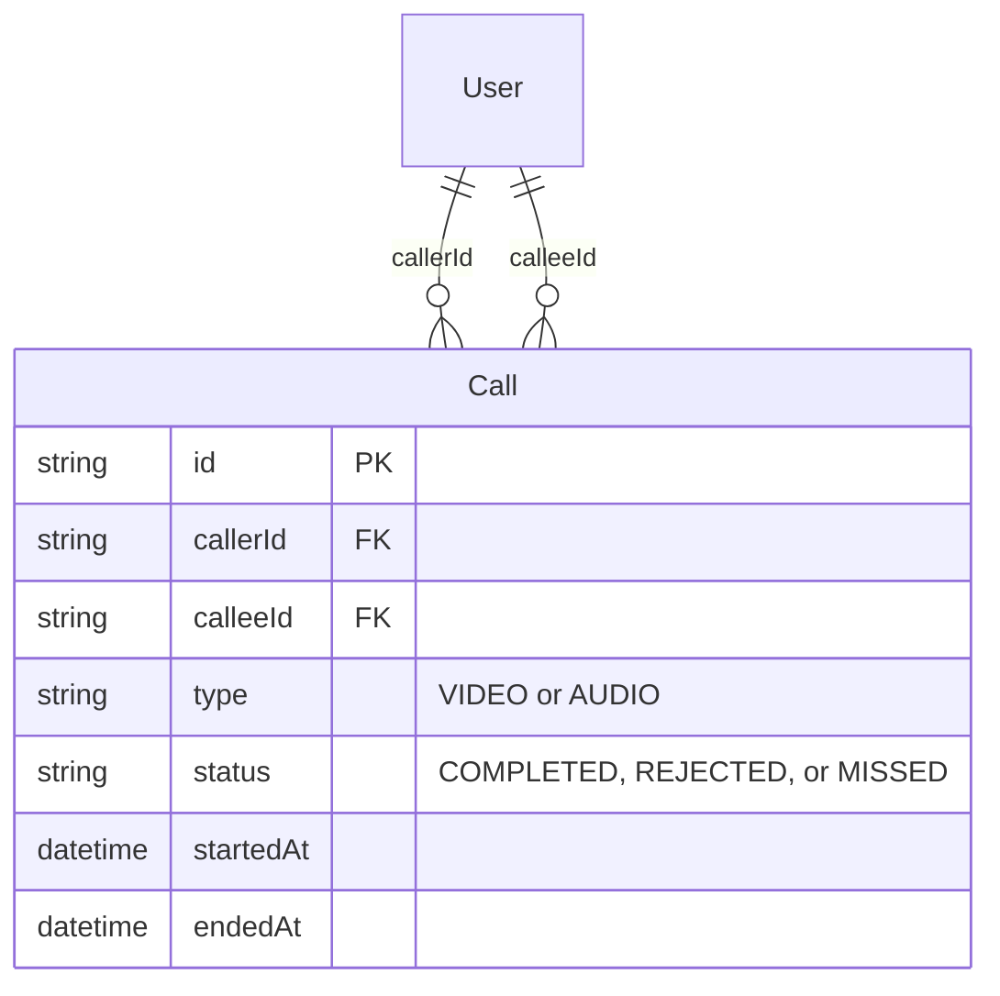

# Video Calling System Architecture

**Status:** All 5 phases complete and verified. The video/voice calling feature (signaling, WebRTC plumbing, app-wide UI, mute/camera, edge-case hardening, and a final full end-to-end regression pass) is done. **One known gap remains, flagged repeatedly but intentionally not yet actioned**: there is still no REST endpoint to read back `Call` history — rows are written correctly but nothing lists them. Left as a deliberate follow-up decision, not an oversight.

## Phase 0 — Locked Decisions

| Decision | Choice |
|---|---|
| Call scope | 1:1 only (no group calls) |
| Connectivity | Public STUN servers only, no TURN relay for now |
| Call history | Persisted — new `Call` table |
| Call type | Two separate entry points: Video call and Voice (audio-only) call |

## Phase 1 — Signaling Backend (Implemented)

**New files**: `server/src/calls/call-state.service.ts` (in-memory active-call tracker, keyed by `callId` with a reverse `userId → callId` index for O(1) busy checks — the same shape as `PresenceService`), `server/src/calls/calls.service.ts` (writes resolved `Call` rows, looks up public caller info for the invite payload), `server/src/calls/calls.module.ts`.

**Changed**: `chat.gateway.ts` gained the 6 new `@SubscribeMessage` handlers below, plus `handleDisconnect` now also resolves any in-progress call for the disconnecting user (ends it, emits `call_end` to the other side, records `COMPLETED` or `MISSED` depending on whether it had connected) — reusing the exact same gateway, no new connection/auth mechanism, per the Phase 0 plan.



One addition beyond the original Phase 0 plan, found necessary while implementing: a `call_unavailable` event (server → caller), sent when the callee has no active socket connection at all — distinct from `call_busy` (callee online but already in a call). Both are pre-checks inside `handleCallInvite` and never create a `Call` row (no call ever actually rang).

| Event | Direction | Purpose |
|---|---|---|
| `call_invite` | caller → callee | `{ callId, type: VIDEO\|AUDIO, offer }` — starts a call, carries the WebRTC SDP offer |
| `call_answer` | callee → caller | `{ callId, answer }` — SDP answer, call connects |
| `ice_candidate` | both directions | `{ callId, candidate }` — relayed as each side discovers connection paths |
| `call_reject` | callee → caller | Declined before answering → `Call` row written with `status: REJECTED` |
| `call_timeout` | caller → callee | No answer within N seconds → cancels the ring, `Call` row written with `status: MISSED` |
| `call_end` | either → other | Hangs up an active or still-ringing call → `Call` row written with `status: COMPLETED` (if it had connected) or `MISSED` (if not) |
| `call_busy` | server → caller | Callee is already in another call — no `Call` row written |
| `call_unavailable` | server → caller | Callee has no active connection at all — no `Call` row written |
| `call_ring_stop` | server → callee (all their tabs/devices) | **Added in Phase 4.** Sent alongside `call_answer`/`call_reject` so that if the callee has the app open in more than one tab, the tabs that *didn't* answer/decline stop ringing silently instead of getting stuck |

### Call Status State Machine (as implemented)



### Verification

Two checks, no browser needed since Phase 1 is backend-only:
1. **Direct socket.io client test** (bypassing any UI) — three real logged-in users, exercising every path: full invite→answer→ICE(both directions)→end, busy (a third caller hits an already-ringing callee), reject, and timeout. All 6 events fired and were received exactly where expected.
2. **Direct database query** confirmed the `Call` table actually persisted the three resolved calls with correct `caller`/`callee`/`type`/`status` (`COMPLETED`, `REJECTED`, `MISSED`) — and confirmed the busy/unavailable cases correctly wrote **no** row at all.

## Phase 2 — WebRTC Client Plumbing (Implemented)

**New files**: `client/src/lib/webrtc.ts` (the `ICE_SERVERS` config from Phase 0, now actually used), `client/src/hooks/useCall.ts` — a reusable hook holding all `RTCPeerConnection`/media/signaling logic, with zero rendering of its own. It exposes `{ status, callType, incomingCall, localStream, remoteStream, error, startCall, answerCall, rejectCall, endCall }`.

**A minimal call UI was wired into `/chat/[username]/page.tsx`** to actually exercise and verify the hook — two icon buttons in the header (disabled when the other person is offline) and a full-screen overlay for ringing/connected states. This is intentionally basic: it only works while that exact conversation page is mounted, so an incoming call from someone you don't currently have open is invisible — **true app-wide reachability (ringing no matter where you are in the app, the same way the chat message toast already works via `bottom-nav.tsx`) is explicitly Phase 3 scope**, not done here.



**A real bug was found and fixed during verification**: the callee's own local camera preview never appeared. Root cause — the `<video>` elements are conditionally rendered based on `call.status`, but the `useEffect` that attaches a stream to a video ref only listed the *stream* in its dependency array, not the *status*. For the caller, `status` is already `'calling'` (so the video tag already exists) by the time the stream arrives, so it worked by coincidence. For the callee, the stream arrives while still in the `'ringing'` UI (no video tag mounted yet) — the effect fired against a `null` ref and never re-fired once the tag actually mounted after answering. Fixed by adding `call.status` to both ref-attachment effects' dependency arrays.

### Verification

Real (not mocked) WebRTC, using Chromium's `--use-fake-device-for-media-stream` flag so no physical camera/mic is needed:
1. Two logged-in browser contexts with camera/microphone permissions granted, fake video (a synthetic animated pattern) and audio devices.
2. Alex called Mia (video) → confirmed Mia's incoming-call screen appeared → Mia answered → confirmed, on **both** sides, `videoWidth: 640, videoHeight: 480, tracks: 1` on **both** the local and remote `<video>` elements (this is what caught the bug above — before the fix, Mia's local preview showed `hasStream: false`).
3. Confirmed the video is genuinely live (Chrome's fake pattern draws a moving frame counter, visibly incrementing across screenshots), not a static frame.
4. Hung up from Alex's side → confirmed Mia's call overlay closed.
5. Repeated with a voice call → confirmed the incoming "voice call" screen text differs from video → Mia declined → confirmed Alex's UI correctly reset to idle (buttons re-enabled).

## Phase 3 — App-Wide Call UI + Mute/Camera (Implemented)

Phase 2's `useCall` was bound to one page (its `otherUserId` param, fixed at mount) — a real limitation for reachability, since it only ever ran while that one conversation was open. Phase 3 lifts it to a single global instance and adds the missing in-call controls.

**Refactored `useCall.ts`**: no longer takes `otherUserId`. `startCall(callee: CallPeer, type)` now takes the target per-call instead of at mount time, so one instance can serve calls to *anyone*, from anywhere. Also added `peer` state (who the current call is with, populated on both the caller and callee side) and `isMuted`/`isCameraOff` + `toggleMute()`/`toggleCamera()`, which flip `track.enabled` on the local stream's audio/video tracks — the standard WebRTC approach (the remote side keeps receiving silence/a black frame rather than the track dropping and requiring renegotiation).

**New `client/src/contexts/call-context.tsx`**: `CallProvider` instantiates `useCall()` exactly once; `useCallContext()` is how any component reads/drives it.

**New `client/src/components/call-overlay.tsx`**: the ringing/connected UI (moved out of the chat page, which now only has the two header buttons that call `call.startCall(conversation.otherUser, type)`), plus the `toast.error(call.error)` effect that used to live on the chat page.

**Mounted once in `(main)/layout.tsx`**, wrapping every page:

```tsx
<CallProvider>
  <div className="flex min-h-full flex-1 flex-col pb-14">
    {children}
    <BottomNav />
  </div>
  <CallOverlay />
</CallProvider>
```

Because this sits at the layout level rather than inside any one page, `CallOverlay` renders on top of whatever page is open the instant a `call_invite` arrives — exactly the same architectural pattern already used for the chat message toast in `bottom-nav.tsx`.

### Verification

Two logged-in sessions again, fake camera/mic:
1. **The actual point of this phase**: Mia stayed on `/home` — never opened the chat page at all — while Alex called her. Confirmed the incoming-call screen rendered anyway, and confirmed her browser's URL never changed from `/home` at any point, including once connected.
2. **Mute**: read the local audio track's `.enabled` before/after clicking Mute — `true` → `false`.
3. **Camera off**: same check on the video track — `true` → `false`; confirmed visually too (the local preview tile goes solid black once toggled, the standard WebRTC behavior for a disabled video track).
4. Hang-up still correctly closes the overlay on the other side.

## Phase 4 — Edge Cases (Implemented)

An audit of Phases 1-3 against realistic failure/multi-device scenarios turned up four gaps. Two were genuinely missing signaling paths; two were client-side correctness bugs.

**1. No-answer timeout.** Phase 1 defined a `call_timeout` *event*, but nothing ever emitted it — an ignored call rang forever. `startCall` (`useCall.ts`) now starts a 45s timer (`RING_TIMEOUT_MS`) right after sending `call_invite`; if the call is still `'calling'` when it fires, it emits `call_timeout`, sets an error ("No answer"), and cleans up. The timer is cleared in `cleanup()` and explicitly in the `call_answer` handler (since a successful connect doesn't call `cleanup()`).

**2. Multi-tab ringing.** Presence already tracks multiple sockets per user (`PresenceService`), so a callee with two open tabs gets `call_invite` in both — but answering/declining on one tab never told the other to stop ringing. Fixed at the signaling layer: `handleCallAnswer` and `handleCallReject` (`chat.gateway.ts`) now also broadcast a new `call_ring_stop { callId }` event to the callee's *own* room. The other tab's `useCall` checks `payload.callId === callIdRef.current && status === 'ringing'` and silently calls `cleanup()` — no error toast, since nothing actually went wrong for that tab.



**3. Mid-call network failure.** No TURN relay (Phase 0 decision) means a dropped ICE connection has no path to recover. `createPeerConnection` now watches `pc.oniceconnectionstatechange` and reacts only on `'failed'` (not `'disconnected'`, which can recover on its own) — emits `call_end`, sets an error ("Connection lost"), and cleans up.

**4. Double-answer race.** Rapidly double-clicking Answer used to start two `getUserMedia()` + `RTCPeerConnection` pairs off the same incoming offer — the first was silently orphaned (camera left on, never released). `answerCall` now consumes `pendingOfferRef.current` (reads it into a local var, then nulls the ref) as the very first synchronous step, so a second invocation sees a null offer and returns immediately.

Also improved: permission-denied and no-device errors from `getUserMedia` now map to readable messages ("Camera/microphone access was denied" / "No camera or microphone found") instead of the raw `DOMException` text.

### Verification

Real WebRTC + real signaling, fake media devices, plus targeted stubbing where the fake-media Chromium flags made a real negative case unreachable:
1. **Ring timeout**: (temporarily shortened to 5s for the test run, reverted after) — invited and never answered; confirmed both sides' overlays auto-closed and the caller saw a "No answer" toast.
2. **Multi-tab ring-stop**: same user logged into two tabs, both rang; answered on Tab A; confirmed Tab B's ringing UI closed with **no** error toast (silent, as intended), while Tab A proceeded to `'connected'`.
3. **Permission denied**: `--use-fake-ui-for-media-stream` auto-grants every prompt, so a real denial can't be triggered through browser permissions — verified instead by stubbing `navigator.mediaDevices.getUserMedia` to reject with a real `NotAllowedError` via `page.addInitScript`. Confirmed the friendly toast text, confirmed the callee's overlay closed, and confirmed the caller's side auto-cancelled (via the `call_reject` this path already sends).
4. **Double-answer**: fired two rapid clicks on Answer; inspected every `<video>` element's `srcObject` stream id directly — exactly one local and one remote stream were created (no duplicate/orphaned stream), and the caller received exactly one working remote track.

## Phase 5 — Final End-to-End Verification (Implemented)

Phases 1-4 each verified their own slice in isolation (signaling alone, WebRTC alone, app-wide UI alone, one edge case at a time). Phase 5 is a single continuous pass exercising the whole feature together, plus the one thing never actually checked before: **that calling doesn't break the chat feature it's bolted onto**, and vice versa.



No new code was needed — this phase is verification-only, confirming Phases 1-4 hold up together rather than only individually.

### Verification

One continuous session, two logged-in users, real WebRTC + fake camera/mic:
1. Sent a plain chat message before any call - received normally.
2. Full video call: invite → Mia's incoming-call screen → answered → confirmed live local+remote video tracks on both sides → toggled mute and camera off mid-call (confirmed both tracks' `.enabled` flipped to `false`) → toggled back on → hung up → confirmed the overlay closed on both sides.
3. **While that call was still connected**, sent a chat message with a typing indicator first - confirmed the typing indicator and the message both arrived normally on the other side, proving the call and chat gateways don't interfere with each other on the same socket connection.
4. A second call (audio) was placed and declined - confirmed both sides reset correctly.
5. Confirmed presence (the online dot) was still accurate after all of the above.
6. Queried the `Call` table directly - the two rows written during this run matched exactly: one `VIDEO`/`COMPLETED` and one `AUDIO`/`REJECTED`, correct caller/callee on both.
7. Checked server logs across the whole run - no errors or exceptions raised by any call-related code path.

## Data Model (Implemented in Phase 1)



A `Call` row is written once a call *resolves* (answered-then-ended, rejected, or timed-out unanswered) — not at the moment of ringing. "Ringing" is transient, in-memory signaling state (like `PresenceService`), not a database status, so there's no `RINGING` row sitting in the table mid-call.

## Connectivity (Implemented in Phase 2, `client/src/lib/webrtc.ts`)

```js
const ICE_SERVERS = [
  { urls: 'stun:stun.l.google.com:19302' },
  { urls: 'stun:stun1.l.google.com:19302' },
];
```

Public Google STUN servers, free, no signup. This lets two browsers discover how to reach each other directly for most network setups. Known limitation: two people both behind strict/corporate NATs may fail to connect peer-to-peer — adding a TURN relay later is purely a config change to this same array, not a re-architecture, so this isn't a decision that locks us in.

## Entry Points (Implemented)

Outgoing calls start from two icon buttons in the `/chat/[username]` conversation header (next to the existing avatar/online-dot), disabled when the other person is offline. **Incoming calls ring app-wide** — `CallOverlay` is mounted once in `(main)/layout.tsx`, not on the chat page, so a call is visible no matter which page you're on, the same way the chat message toast already works.

The full signaling event table and the as-implemented call status state machine are documented above, under Phase 1.
